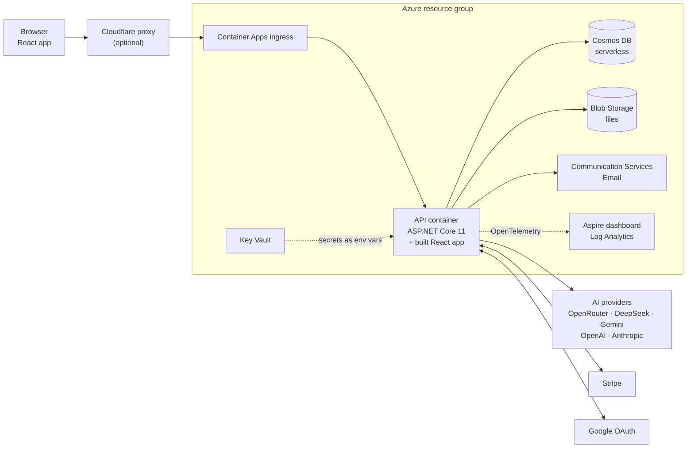
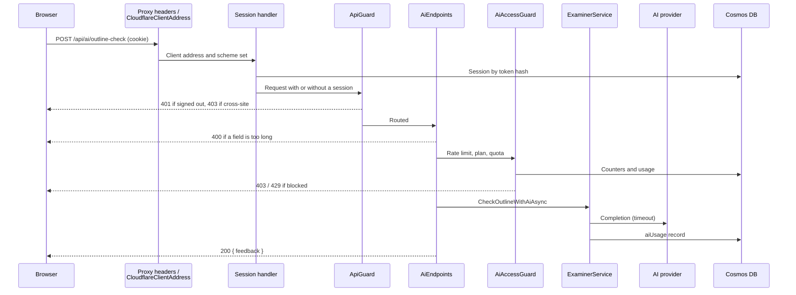
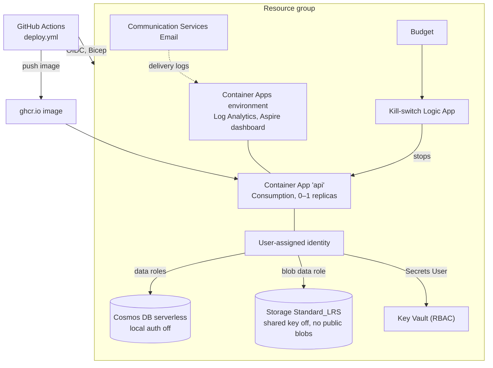

# Architecture

How Escribot is put together: the parts, how a request moves through them, where data
lives, and how the same app runs locally and in Azure. This page is the overview. Each
area has its own detailed page:

| Page | Covers |
|---|---|
| [sign-in.md](../server/docs/sign-in.md) | Accounts, sessions, Google sign-in, email |
| [data-api.md](../server/docs/data-api.md) | The non-AI routes and the wire format |
| [ai.md](../server/docs/ai.md) | Providers, model choice, quotas, failure handling |
| [billing.md](../server/docs/billing.md) | Stripe and the admin routes |
| [data-model.md](../server/docs/data-model.md) | Cosmos DB containers, documents and repositories |
| [README](../README.md) | Features, settings, local setup and the Azure deployment steps |

## Overview

Escribot deploys as **one container image**. It holds an ASP.NET Core 11 API that also
serves the built React app, so pages and the API share one origin and one session cookie.
The API keeps its state in Azure Cosmos DB (documents) and Blob Storage (uploaded chart
images). It calls out to AI providers, Stripe, Google and Azure Communication Services.

## Repository map

| Path | What |
|---|---|
| `client/` | The browser app: Vite, React 19, React Router, Tailwind 4 |
| `server/src/Escribot.Api` | The API, and the host of the built browser app |
| `server/src/Escribot.AppHost` | Aspire AppHost: runs everything locally and describes the Azure resources |
| `server/src/Escribot.ServiceDefaults` | OpenTelemetry, health checks, service discovery, HTTP resilience |
| `server/src/Shared` | `DataModelSchema.cs`: the database, containers and blob container, compiled into both the AppHost and the API |
| `server/tests/Escribot.Api.Tests` | xUnit tests |
| `infra/` | Bicep for the Azure deployment |
| `.github/workflows/` | `ci.yml` (checks) and `deploy.yml` (build and deploy) |
| `scripts/` | `test-isolation.mjs` (tenant isolation, end to end) and `test-cloudflare-ip.sh` |

## Browser app

`client/src` has three folders:

- `pages/`: one module per route, each exporting a `loader` and a page component. `router.tsx`
  maps addresses to them with React Router's `createBrowserRouter`.
- `components/`: the screens and widgets the pages are built from (`CoachWorkspace`,
  `InsperaSimulator`, `EvaluationWorkbench`, `VaultClient`, …).
- `lib/`: API calls, shared types and helpers.

Loaders fetch a page's data before it renders, mostly from `GET /api/pages/*`, which answers
in the shape of the page component's props. `loadJson` (`lib/api.ts`) sends a 401 to
`/login?next=...` and turns any other error into the route's error page, so a 404 from the
API shows the not-found page.

The JSON the app receives is built by `server/src/Escribot.Api/Api/Wire.cs`, and
`client/src/lib/types.ts` declares it. Change them together. Browser errors are reported to
`POST /api/errors` (`lib/report-client-error.ts`). Grading reads the NDJSON stream from
`/api/ai/evaluate` (`lib/client-evaluate.ts`).

## API

### Startup

`Program.cs` registers each area with one extension method and then builds the pipeline.
Order matters:

| Step | Method | Where |
|---|---|---|
| Services | `AddServiceDefaults` | `Escribot.ServiceDefaults` |
| | `AddAppOptions` (validated; startup fails if a required setting is missing) | `Configuration/` |
| | `AddStorage` (Cosmos DB, Blob Storage, repositories) | `Storage/`, `Data/` |
| | `AddEmail` | `Email/` |
| | `AddAuth` (Identity, sessions, Google) | `Auth/` |
| | `AddDataApi` (AI clients, billing, helpers) | `Api/ApiExtensions.cs` |
| Pipeline | `UseProxyHeaders`: forwarded headers, and `CloudflareClientAddress` behind Cloudflare | `Auth/AuthExtensions.cs` |
| | `UseHsts` outside Development, `UseSecurityHeaders` | `Hosting/` |
| | `UseClientAppFiles`: the built app's static files | `Hosting/ClientApp.cs` |
| | `UseAuth`: `ApiErrorHandler`, authentication, `ApiGuard`, authorization | `Auth/AuthExtensions.cs` |
| | `MapDataApi`: every route under `/api` | `Api/ApiExtensions.cs` |
| | `MapDefaultEndpoints`: `/alive`, `/health` | `Escribot.ServiceDefaults` |
| | `MapClientApp`: `index.html` for every other page address; unknown `/api` paths are a JSON 404 | `Hosting/ClientApp.cs` |

### Folders of `Escribot.Api`

| Folder | Responsibility | Detail |
|---|---|---|
| `Api/` | Minimal-API endpoints by area (writing, account, backup, AI, billing, admin, pages), `Wire`, usage, error reporting, the image store | [data-api.md](../server/docs/data-api.md) |
| `Auth/` | Accounts, sessions, `ApiGuard`, Google sign-in, client address | [sign-in.md](../server/docs/sign-in.md) |
| `Ai/` | Model routing, quotas, prompts, provider clients | [ai.md](../server/docs/ai.md) |
| `Billing/` | Stripe gateway, subscription sync, price catalogue | [billing.md](../server/docs/billing.md) |
| `Data/` | Repository interfaces (`Repositories.cs`), records (`Models/`), the Cosmos implementation (`Cosmos/`), seed data | [data-model.md](../server/docs/data-model.md) |
| `Storage/` | Cosmos DB and Blob clients, health checks | [data-model.md](../server/docs/data-model.md) |
| `Email/` | `IEmailSender` over ACS, or the console when email is not configured | [sign-in.md](../server/docs/sign-in.md) |
| `Hosting/` | Serving the browser app, security headers | |
| `Configuration/` | `AppOptions` and its validator | [README](../README.md#settings-and-secrets) |
| `Common/` | Plans, IELTS helpers, `ApiKeyProtector`, chart spec normalising | |

Endpoints depend on the repository interfaces, never on the Cosmos SDK, which is used only
in `Data/Cosmos`.

### A request, end to end

A signed-in user asks for an outline check:

An exception anywhere after `ApiErrorHandler` is recorded in the `errors` container and
answered with a fixed JSON 500. Nothing about the exception reaches the caller.

## Data and tenancy

- One Cosmos DB database, `escribot`, with five containers (`DataModelSchema.cs`):
  - `users` (`/userId`): everything a user owns;
  - `shared` (`/pk`): curated prompts;
  - `lookups` (`/id`): email, session token, Stripe customer → user id;
  - `counters` (`/id`): rate limits and the Free daily cap;
  - `errors` (`/day`): kept for 30 days.
- Every repository method that touches user data takes the owner's user id, and the read or
  write stays inside that user's partition. Another user's id reads as nothing, so the API
  answers 404, never 403. Signed-out calls answer 401 (`ApiGuard`).
- Uploaded images are in the private `files` blob container, under the owner's id, and
  are served only through `GET /api/images/{id}`.
- The app never creates containers. The AppHost creates them locally, and Bicep creates them
  in Azure, so the API's identity needs data access only.

Detail: [data-model.md](../server/docs/data-model.md).

## Cross-cutting concerns

| Concern | How |
|---|---|
| Secrets | No values in the repository. Locally they come from .NET user secrets, which the AppHost passes in. In Azure they are Key Vault secrets that Container Apps hands to the API as environment variables |
| Users' API keys | Encrypted with `ApiKeyProtector` (AES-256-GCM, `App:EncryptionSecret`), never exported, shown masked |
| Sessions | Opaque random token in the `escribot-session` cookie; only its SHA-256 is stored, and the document expires by TTL |
| Cross-site requests | `ApiGuard` refuses state-changing requests that come from another site's page; the cookie is SameSite |
| Rate limits | Counted in Cosmos DB (`CosmosRateLimiter`), so they hold across replicas. AI quotas also use an in-process tracker; see [ai.md](../server/docs/ai.md#metering) |
| Client address | `X-Forwarded-For` only when `App:TrustForwardedHeaders`; `CF-Connecting-IP` only from Cloudflare's ranges |
| Errors | Server and browser errors go to the `errors` container with credentials redacted (`ErrorSanitizer`) |
| Telemetry | OpenTelemetry traces, metrics and logs through ServiceDefaults; the Aspire dashboard shows them locally and in Azure |
| Health | `/alive` (the process is up) and `/health` (Cosmos DB and Blob Storage are reachable), used by the Container Apps probes |
| Headers | HSTS outside Development; `X-Content-Type-Options`, frame denial, Referrer-Policy and Permissions-Policy on every response |

## Environments

### Local

`dotnet run --project server/src/Escribot.AppHost` starts:

- the API;
- the Linux Cosmos DB emulator, pinned by image digest;
- Azurite for Blob Storage;
- the Vite dev server (`web`) on port 5173, which passes `/api` on to the API
  (`client/vite.config.ts`).

The AppHost creates the database, the containers and the blob container from `DataModelSchema`.
It generates `encryption-secret` into user secrets on the first run. The Aspire dashboard
shows each resource's logs and traces.

### Azure

| Bicep module (`infra/`) | Creates |
|---|---|
| `main.bicep` | The resource group, every module below, the monthly budget |
| `aca/` | The Container Apps environment, Log Analytics, the Aspire dashboard |
| `api/api-containerapp.bicep` | The `api` Container App: image, environment, probes, scaling, ingress rules |
| `api-identity/`, `api-roles-*` | The API's managed identity and its role assignments on Cosmos DB, Storage and Key Vault |
| `cosmos/`, `storage/`, `vault/`, `acs/` | The data stores, the vault and email (with its send and delivery logs sent to Log Analytics) |
| `budget-killswitch/` | The Logic App that stops the app when the budget is reached |

`ci.yml` runs on every pull request and every push to `main`. It has three jobs:

- `secret-scan`;
- `client`: lint, typecheck and build;
- `dotnet`: build, test, then build the Docker image, check that it starts only with its
  secret, and run the tenant-isolation test against it.

`deploy.yml` runs on `main` in the `production` environment, which needs a reviewer. It
builds and pushes the image to GHCR. It then refuses to run while the kill switch has the
app stopped, deploys the Bicep, rolls out the image and checks health.

## Testing

| Kind | Run with | Needs |
|---|---|---|
| Unit and in-memory API tests | `dotnet test --filter "Category!=Integration"` | Nothing |
| `Integration` | `dotnet test` | A container runtime; starts the AppHost with the emulators |
| `Image` | `ISOLATION_TEST_IMAGE=... dotnet test --filter "Category=Image"` | A built image |
| End to end | `BASE_URL=... node scripts/test-isolation.mjs` | Any running deployment |

## Key decisions

- **One image, one origin.** The API serves the browser app, so there is no CORS, the
  session cookie stays first-party, and there is a single thing to deploy and scale.
- **$0 when idle.** The app scales to zero on the Consumption plan and Cosmos DB is
  serverless. There is no container registry (GHCR is free) and no Front Door
  (Cloudflare's free plan absorbs floods). Log Analytics has an ingestion cap. A budget
  kill switch bounds the worst case.
- **At most one replica.** This caps compute spend, and it makes the in-process AI quota
  tracker exact. Raising `maxReplicas` needs a shared reservation store first.
- **Tenancy is the partition.** Putting each user's data in its own partition makes
  isolation a property of the storage layout, not of every query remembering a filter.
- **One schema definition.** `DataModelSchema.cs` feeds the emulator, the Azure definitions
  and the API, so they cannot drift.
- **Managed identity everywhere in Azure.** Cosmos DB and Storage have key-based access
  turned off, and the only secrets are the app's own, in Key Vault.
