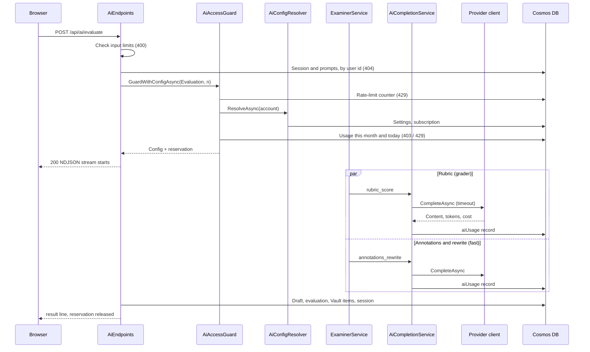

# AI

How Escribot calls language models: which provider, model and key a request uses, how
platform-paid requests are metered, and what happens when a call fails. The code is in
`Escribot.Api/Ai`, `Escribot.Api/Api/AiEndpoints.cs`, `Escribot.Api/Api/Usage.cs` and
`Escribot.Api/Common/Plans.cs`. Provider settings (saving keys, listing models) are routes
of the data API; see [data-api.md](data-api.md).

## Parts

| Part | What it does |
|---|---|
| `AiEndpoints` | The AI routes. Checks input limits, calls the guard, then the examiner, then saves the results |
| `AiAccessGuard` | The per-user rate limit, the Free-plan email check, the Free daily cap and the monthly quotas |
| `AiQuotaTracker` | Counts quota units still in flight, so concurrent requests cannot both take the last unit |
| `AiConfigResolver` | Picks the provider, model and key for each role (`ResolvedAiConfig`) and works out the plan |
| `ExaminerService` | Builds the prompts for each feature, runs them via `ChatClientAgent`, parses the JSON, and has a local fallback |
| `AiCompletionService` | Executes `Microsoft.Agents.AI` `ChatClientAgent` instances (`RunAsync` / `RunStreamingAsync`) with per-call timeouts and disconnect-safe usage recording |
| `EscribotAgentFactory`, `UserHistoryTools` | Creates stateless `ChatClientAgent` instances per request and `userId`-scoped read-only `AITool`s for `DrillGeneratorAgent` (`Ai/Agents/`) |
| `UserChatClientFactory`, `OpenRouterHttpHandler`, `MeteringChatClient` | Builds per-request `IChatClient` instances (`OpenAI` SDK for OpenAI/OpenRouter/DeepSeek, official `Google.GenAI` SDK for Gemini, `Microsoft.Agents.AI.Anthropic` for Anthropic) wrapped in OpenTelemetry (`EnableSensitiveData = false`), usage/cost metering, and optional function invocation |
| `AiProviders` (`Api/Usage.cs`) | The provider ids, their default models per role and their fallback lists |
| `UsageService` (`Api/Usage.cs`) | Which features count toward which quota, and the usage summary shown in Settings |
| `OpenRouterModelsClient`, `ProviderModelsClient`, `ModelPicker` | Live model lists and automatic model picks for Settings |
| `JsonExtractor` | Pulls the JSON object out of a model's answer, even with Markdown fences or prose around it |
| `L1Profiles`, `DrillTemplates` | Coaching notes per first language, and the built-in micro-drills |

## Routes

All need a session (see [sign-in.md](sign-in.md)). Errors are `{ "error": "...", "code"?: "..." }`.

| Route | Quota | Notes |
|---|---|---|
| `POST /api/ai/evaluate` | Evaluation, 1 per submission | `{ sessionId, submissions[1..2], totalSecondsSpent? }`. Answers a stream of NDJSON lines (see below). 404 for a session or prompt that is not the user's |
| `POST /api/ai/outline-check` | Assist | `{ outline, promptText, taskType, promptId? }` → `{ feedback }` |
| `POST /api/ai/toolkit` | Assist | `{ tool, selectedText, promptText, taskType, fullEssayContext? }` → `{ result }` |
| `POST /api/ai/generate-prompt` | Assist | `{ taskType, category?, topic? }` → `{ prompt }`, saved as the user's prompt with `source: "ai_generated"` |
| `POST /api/ai/transform-svg` | Assist (Pro / Owner only) | `{ imageDataUrl, category?, promptText? }` or `{ promptId, category?, promptText? }` → `{ svgDataUrl, extractedVisualSpec? }`. Redraws an uploaded Task 1 raster image into a sanitized SVG using the `vision` role. With `promptId` (and no `imageDataUrl`) the image is read from the user's saved prompt, so it is never sent back: 404 for a prompt that is not the user's own, 400 when it has no image or its image is already an SVG. Nothing is saved; the browser saves the SVG with `PATCH /api/prompts/{id}`. 403 `upgrade_required` on Free (even with a user API key) |
| `POST /api/drills` | Assist | `action: "generate"` → `{ drillId, challenge }`; `action: "score"` → `{ score }`, saved on the drill when `drillId` is the user's |
| `GET /api/ai/models` | None | OpenRouter's public catalogue; `?type=vision` keeps the models that read images |

Each route checks the length of every text field before the guard runs, so a request that is
too large is a 400 and uses no quota. The limits are at the top of `AiEndpoints.cs`
(20,000 characters for essays and prompts, for example). An unexpected failure is a 500 with
the route's fixed message (`.OnFailure(...)`); the exception is recorded, never returned.

### The evaluate stream

Grading takes up to about a minute, so `/api/ai/evaluate` answers `200` right away with
`text/event-stream` when the client sends `Accept: text/event-stream` (or `application/x-ndjson`
otherwise). As `ExaminerRubricAgent` and `ExaminerCoachAgent` stream via `AIAgent.RunStreamingAsync`,
`JsonMilestoneScanner` detects top-level JSON sections and emits semantic `progress` milestones:

| `type` / SSE `event` | When |
|---|---|
| `progress` | Each stage and streamed section milestone (`stage` is the text shown to the user) |
| `ping` (`: keepalive`) | Every 4 seconds, so proxies (Cloudflare / Container Apps) do not close an idle connection |
| `result` | Once at the end: `{ sessionId, weightedBand, results: [{ draftId, version, evaluationId, payload, ... }] }` |
| `error` | Instead of `result`: `{ error, isTimeout }`. The message is fixed text from `DescribeEvaluateFailure`; it says when the user's own key was rejected or rate-limited, and never contains the provider's answer |

The browser app reads it in `client/src/lib/client-evaluate.ts` (using `client/src/lib/sse.ts`). A request the guard blocks
gets a normal JSON error before the stream starts.

## Roles and model choice

Every request runs on one of three roles:

| Role | Used for |
|---|---|
| `grader` | The 4-criterion rubric score |
| `fast` | Annotations and rewrite, outline check, toolkit, prompt generation, drills, and the rubric when the grader fails |
| `vision` | Reading uploaded Task 1 chart screenshots (sent at `detail: "high"` to OpenAI-compatible providers) |

`AiConfigResolver.ResolveAsync` picks a `ModelTarget(Provider, Model, ApiKey, KeySource)` for
each role, in this order:

1. The user's own key for the provider chosen for the role, with the chosen model.
2. Otherwise, any other provider the user has a key for, with its default model for the role.
   Once a user has saved a key, platform keys are never used for them.
3. Otherwise the platform's keys (`OPENROUTER_API_KEY`, `DEEPSEEK_API_KEY`, `GEMINI_API_KEY`,
   `OPENAI_API_KEY`, `ANTHROPIC_API_KEY`; `AiProviders.PlatformKeySetting`). Only plans with
   `CanChooseModels` (Pro and owner) get their chosen provider and model. Free always gets
   the first provider with a platform key (OpenRouter first) and its default models.
4. No key at all: `KeySource` is `"none"`.

Saved keys are decrypted with `ApiKeyProtector` (AES-256-GCM, keyed by `App:EncryptionSecret`).
The resolved config also carries the user's current and target band and first language,
which go into the prompts.

The defaults and fallback lists for each provider are in `AiProviders.Defaults`. OpenRouter
gets the chosen model plus its fallbacks in one `models` list (at most 3, its limit) and is
sent `provider.data_collection: "deny"`. The Gemini client tries the fallbacks one at a time.

## Metering

`AiAccessGuard.GuardWithConfigAsync(account, kind, units)` runs before any model call:

1. **Rate limit.** 20 AI requests per minute per user (`ai:{userId}`), counted in the Cosmos DB
   `counters` container so the limit holds across replicas. Over the limit: 429 `rate_limited`
   with `Retry-After`.
2. **Own key or no key.** If no role uses a platform key, the request goes through unmetered.
3. **Real address.** In production, Free accounts may use platform keys only when their email
   is verified or invited (`UsageService.IsTrustedForFreeUse`). Otherwise: 403 `verification_required`.
4. **Reserve, then check.** The request reserves its units in `AiQuotaTracker`, then reads the
   stored usage and compares stored usage plus units in flight with the limits:
   - the Free daily cap across all accounts (`FREE_PLAN_DAILY_AI_CAP`, unset means no cap):
     429 `free_capacity_reached`;
   - the monthly quota for the kind (`PlanCatalog`: by default Free 3 evaluations and 30 assists, Pro 100
     and 1,500, owner unlimited, overridable by the `*_PLAN_*_PER_MONTH` settings; months are UTC): 429 `quota_exceeded`, with `upgradeUrl` when
     a Free user can upgrade.

   The reservation is held until the response is finished, the end of the stream for
   `evaluate`. The in-flight counts live in the process, which is correct because the
   Container App runs at most one replica (`maxReplicas: 1`).

After each model call `AiCompletionService` writes an `aiUsage` document with the feature,
provider, model, key source, plan, tokens and USD cost. Quotas count only `keySource:
"platform"` records of the billable features (`UsageService.EvaluationFeatures` and
`AssistFeatures`). It also increments the Free daily counter for billable Free platform calls.
When a model's answer cannot be parsed, the call is recorded as `{feature}_invalid_output`,
which is not billable, so a retry on another model does not use two units.

OpenRouter reports an exact USD cost with each HTTP response. `OpenRouterHttpHandler` adds the
costs of every call a request makes, so a `drill_generate` that uses its tools records the
total, not only the last call. If the browser disconnects mid-call after the provider has
started answering, the call is recorded as `{feature}_aborted` (not billable). Streaming
providers send token counts only at the end, so when none have arrived the record carries
estimates (about 4 characters per token, from the prompt and the text streamed so far).

`evaluate` finishes saving after the grading succeeds even if the browser has gone: the
draft, evaluation, Vault items and the completed session are written with a 10-second grace
token instead of the request's.

## When a call fails

- **Timeouts.** Each call sets its own timeout (20–40 seconds, in `ExaminerService`).
  `AiCompletionService` turns it into a `TimeoutException`. The provider HTTP clients have
  no resilience handlers and no client timeout of their own (`ApiExtensions.AddAiClient`).
- **No automatic retries.** The provider SDKs do not retry on their own (`RetryPolicy` with
  no retries for the OpenAI SDK clients, `MaxRetries = 0` for Anthropic): a completion is billed
  per call, and the fallbacks below decide what happens next.
- **Model fallbacks.** OpenRouter routes over up to 3 models itself. Gemini tries the next
  fallback model on 404, 429, 500, 502, 503 and 504 before any text has streamed.
- **Empty answers.** When an OpenRouter model answers with empty content, the text of its
  `reasoning` field is used instead; a `refusal` with no reasoning fails with the refusal text.
- **Output limits.** Anthropic calls that set no limit use `max_tokens` 4096. Gemini adds
  4096 tokens (at least 8192 in all) to a set limit for its thinking tokens.
- **Grader fails.** The rubric is retried once on the `fast` role (`rubric_score_fallback`),
  if that is a different model.
- **Annotations fail.** The scores are kept, and the annotations and Vault items come from the
  local heuristic scan, with a note that the rewrite timed out.
- **No key.** Every feature has a local answer that needs no model: `BuildHeuristicDiagnosticPreview`
  for grading (`providerUsed: "local-diagnostic-preview"`), rule-based feedback for outlines and
  toolkit runs, built-in prompts, and `DrillTemplates` with simple local scoring for drills.
- **Unknown provider.** `UnsupportedAiProviderException`, shown as "choose another provider".
- **Keys in errors.** Gemini's key goes in the `x-goog-api-key` header, not the URL, and
  `ErrorSanitizer` (`Data/Cosmos/ErrorEvents.cs`) redacts anything shaped like a credential
  before an error is stored.

## Request flow

